# Traefik Forward Auth アーキテクチャドキュメント

## 概要

Traefik Forward Authは、Traefikリバースプロキシと連携して動作するOAuth/OIDC認証ミドルウェアサービスです。Traefikの Forward Authentication 機能を利用して、バックエンドサービスへのアクセス前にユーザー認証を行います。

## アーキテクチャ概要

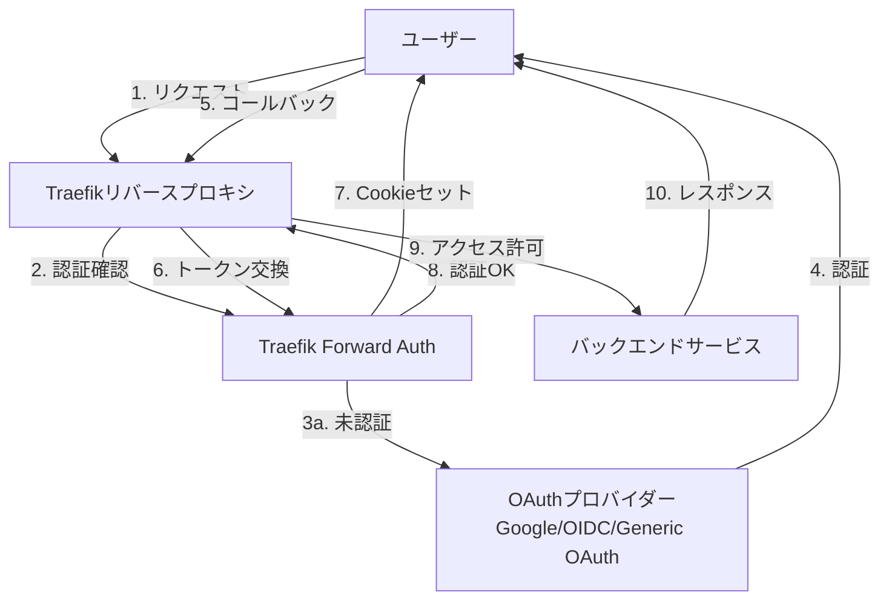

## 主要コンポーネント

### 1. エントリーポイント (`cmd/main.go`)

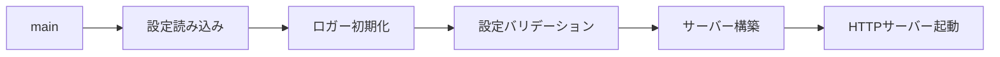

**責務:**
- グローバル設定の初期化
- ロガーのセットアップ
- HTTPサーバーの起動 (デフォルト: ポート4181)

### 2. サーバー (`internal/server.go`)

**主要ハンドラー:**

| ハンドラー | パス | 責務 |
|---------|------|------|
| RootHandler | / | すべてのリクエストのエントリーポイント |
| AllowHandler | (ルールベース) | 認証なしでリクエストを許可 |
| AuthHandler | (ルールベース) | 認証を要求し、Cookieを検証 |
| AuthCallbackHandler | /_oauth | OAuthコールバックを処理 |
| LogoutHandler | /_oauth/logout | ログアウト処理 |

### 3. 認証フロー (`internal/auth.go`)

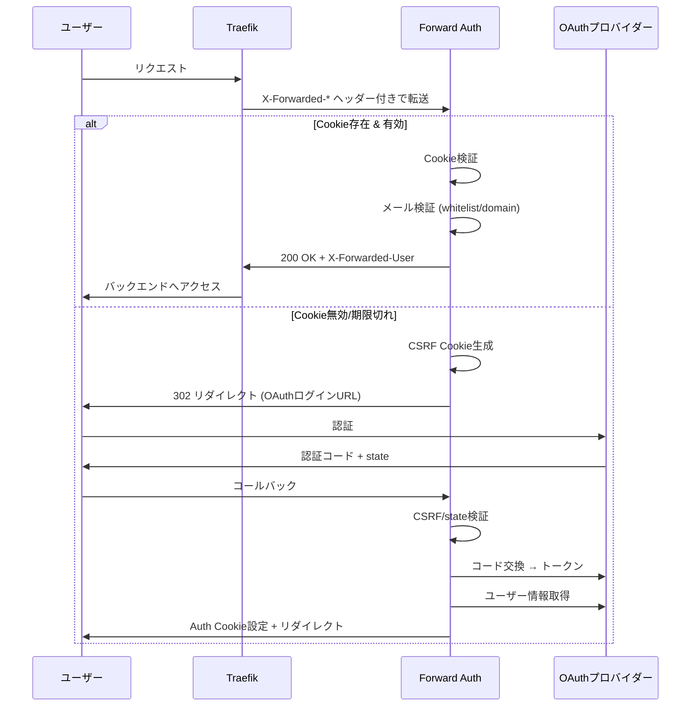

### 4. 設定管理 (`internal/config.go`)

**主要設定項目:**

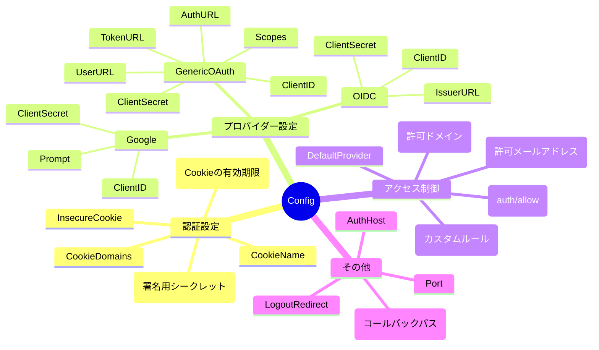

### 5. プロバイダー (`internal/provider/`)

**プロバイダーインターフェース:**

```go
type Provider interface {
    Name() string
    GetLoginURL(redirectURI, state string) string
    ExchangeCode(redirectURI, code string) (string, error)
    GetUser(token string) (User, error)
    Setup() error
}
```

**実装プロバイダー:**

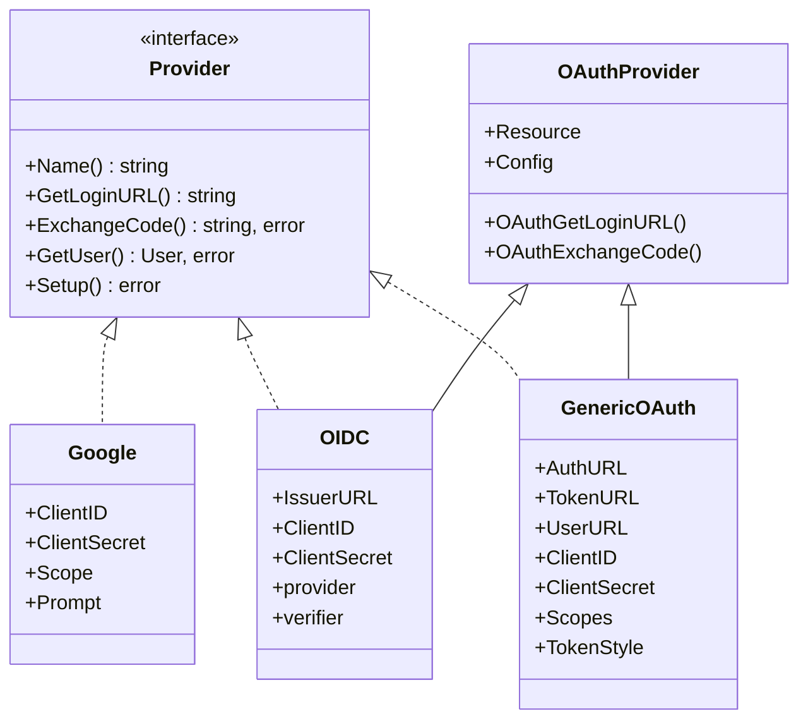

## 動作フロー詳細

### 認証リクエストフロー

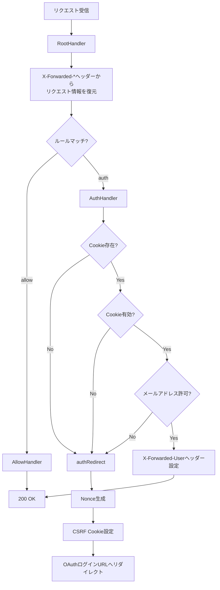

### OAuthコールバックフロー

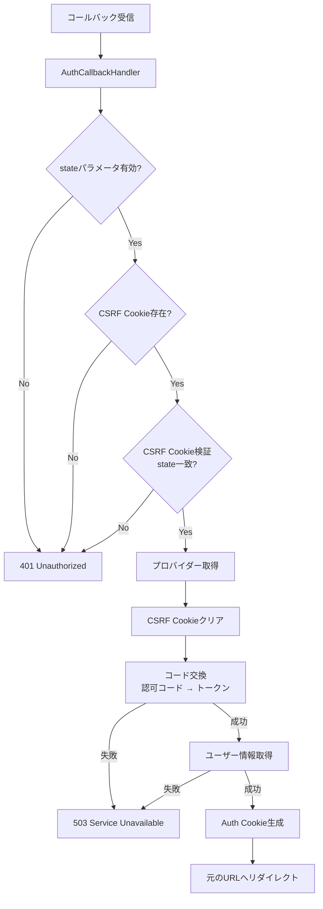

### Cookie検証フロー

```mermaid
flowchart TD
    A[Cookie検証開始] --> B[Cookie値を分割<br/>hash | expires | email]
    B --> C{フォーマット正しい?}

    C -->|No| D[エラー: Invalid cookie format]

    C -->|Yes| E[MAC署名をデコード]
    E --> F[期待される署名を生成<br/>HMAC-SHA256 secret, domain, email, expires]
    F --> G{署名一致?}

    G -->|No| H[エラー: Invalid cookie mac]

    G -->|Yes| I{有効期限内?}
    I -->|No| J[エラー: Cookie has expired]

    I -->|Yes| K[メールアドレス検証]
    K --> L{whitelistに存在?}
    L -->|Yes| M[認証成功]

    L -->|No| N{許可ドメイン?}
    N -->|Yes| M
    N -->|No| O[認証失敗]
```

## セキュリティ機能

### 1. Cookie署名

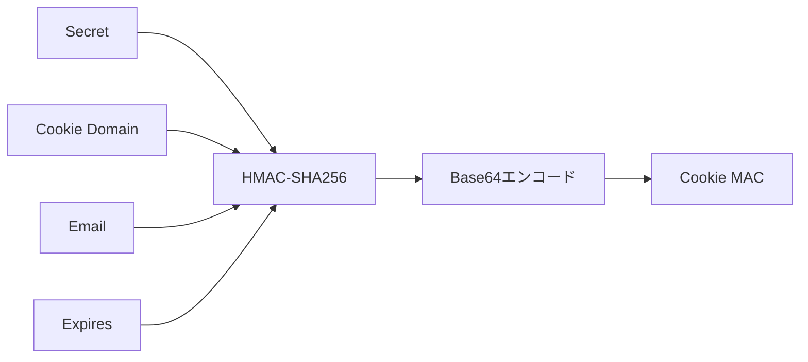

**Cookie形式:** `MAC|有効期限(Unix timestamp)|メールアドレス`

### 2. CSRF対策

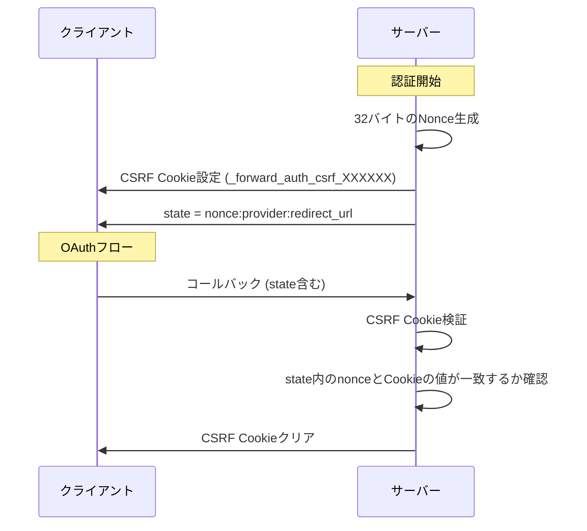

### 3. アクセス制御

**ルールベースの制御:**

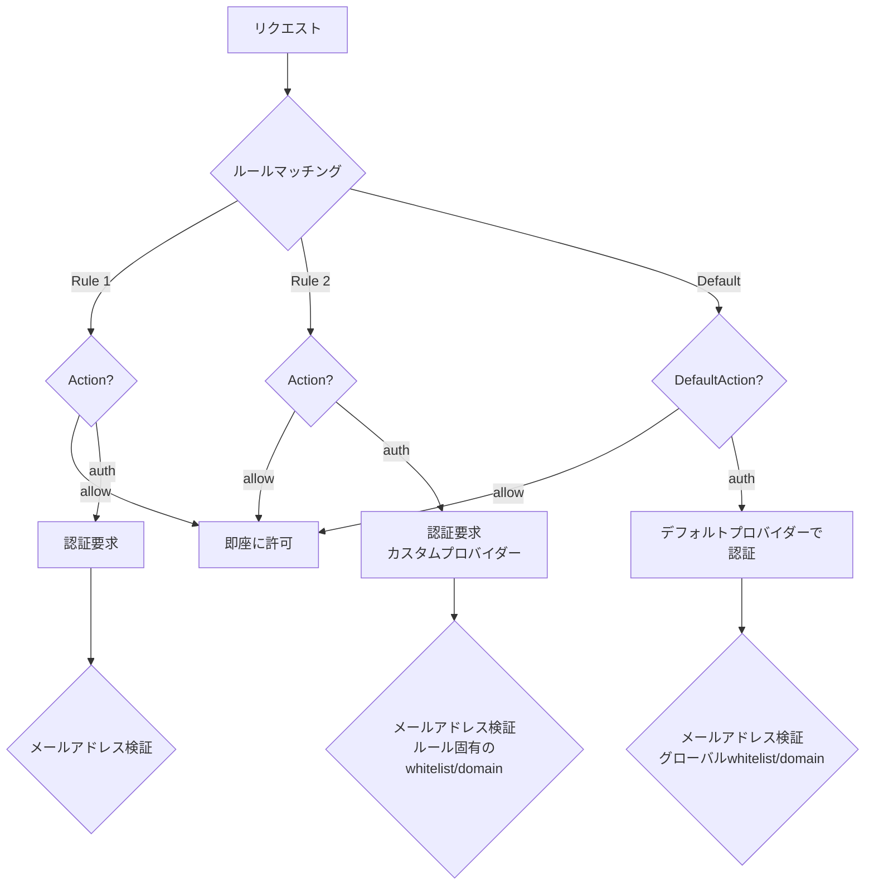

**メールアドレス検証ロジック:**

1. **Whitelist検証:** 完全一致でメールアドレスをチェック
2. **Domain検証:** `@`以降のドメインをチェック
3. **MatchWhitelistOrDomain:** どちらか一方でOK (無効の場合は両方必要)

## 設定例

### 基本設定

```ini
# 必須設定
secret = your-secret-key-here
port = 4181

# プロバイダー設定
default-provider = google

[providers.google]
client-id = your-google-client-id
client-secret = your-google-client-secret
prompt = select_account

# アクセス制御
domain = example.com
whitelist = admin@example.com,user@example.com
```

### ルールベース設定

```ini
secret = your-secret-key

# デフォルトは認証必須
default-action = auth
default-provider = google

# 公開パスは認証不要
rule.public.action = allow
rule.public.rule = PathPrefix(`/public`)

# 管理者パスはホワイトリスト限定
rule.admin.action = auth
rule.admin.rule = PathPrefix(`/admin`)
rule.admin.whitelist = admin@example.com
rule.admin.provider = google

# API用にOIDC認証
rule.api.action = auth
rule.api.rule = PathPrefix(`/api`)
rule.api.provider = oidc

[providers.oidc]
issuer-url = https://accounts.google.com
client-id = your-oidc-client-id
client-secret = your-oidc-client-secret
```

## Traefikとの統合

### Docker Compose例

```yaml
services:
  traefik:
    image: traefik:v2.x
    command:
      - "--providers.docker=true"
    ports:
      - "80:80"
      - "443:443"
    volumes:
      - /var/run/docker.sock:/var/run/docker.sock

  traefik-forward-auth:
    image: thomseddon/traefik-forward-auth:latest
    environment:
      - SECRET=something-random
      - PROVIDERS_GOOGLE_CLIENT_ID=your-client-id
      - PROVIDERS_GOOGLE_CLIENT_SECRET=your-client-secret
      - DOMAIN=example.com
    labels:
      - "traefik.http.middlewares.traefik-forward-auth.forwardauth.address=http://traefik-forward-auth:4181"
      - "traefik.http.middlewares.traefik-forward-auth.forwardauth.authResponseHeaders=X-Forwarded-User"

  whoami:
    image: traefik/whoami
    labels:
      - "traefik.http.routers.whoami.rule=Host(`whoami.example.com`)"
      - "traefik.http.routers.whoami.middlewares=traefik-forward-auth@docker"
```

### リクエストフロー

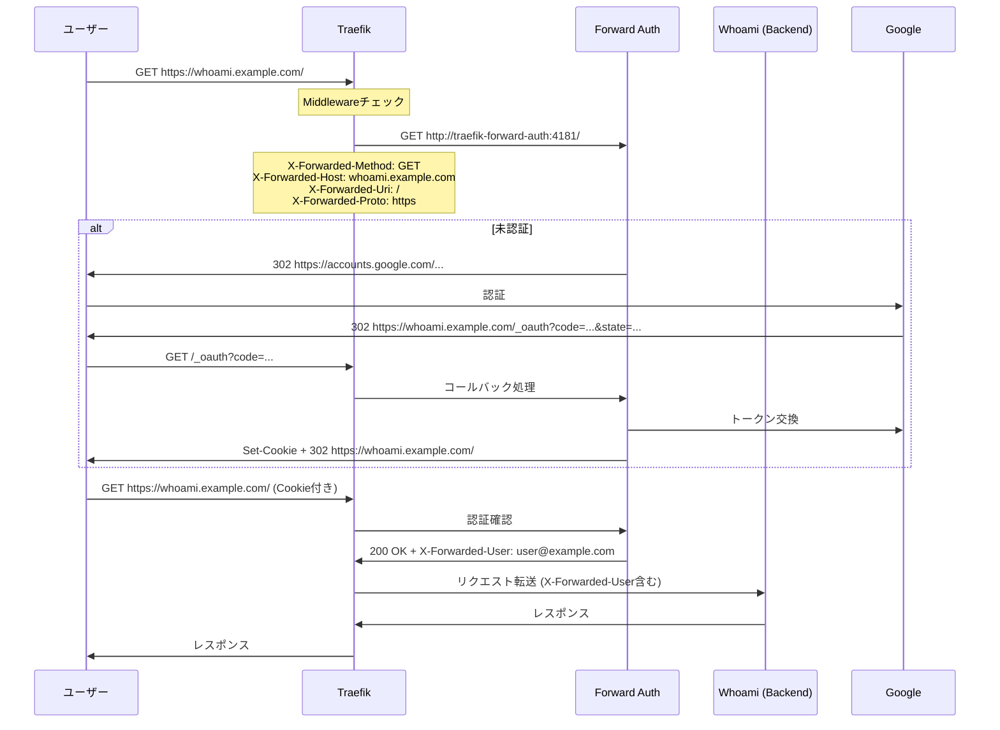

## 技術スタック

- **言語:** Go
- **主要ライブラリ:**
  - `github.com/sirupsen/logrus` - ロギング
  - `github.com/traefik/traefik/v2/pkg/muxer/http` - ルーティング
  - `golang.org/x/oauth2` - OAuth2クライアント
  - `github.com/coreos/go-oidc` - OIDC検証
  - `github.com/thomseddon/go-flags` - CLI引数パース

## まとめ

Traefik Forward Authは、以下の特徴を持つ軽量な認証ゲートウェイです:

✅ **マルチプロバイダー対応** - Google、OIDC、汎用OAuth2
✅ **柔軟なアクセス制御** - ルールベース、ドメイン、ホワイトリスト
✅ **セキュア** - HMAC署名Cookie、CSRF対策
✅ **Traefik統合** - Forward Authミドルウェアとしてシームレスに動作
✅ **軽量** - 単一バイナリ、低リソース使用量

このアーキテクチャにより、既存のアプリケーションに認証機能を追加する際、アプリケーション側のコード変更なしに認証レイヤーを挿入できます。
